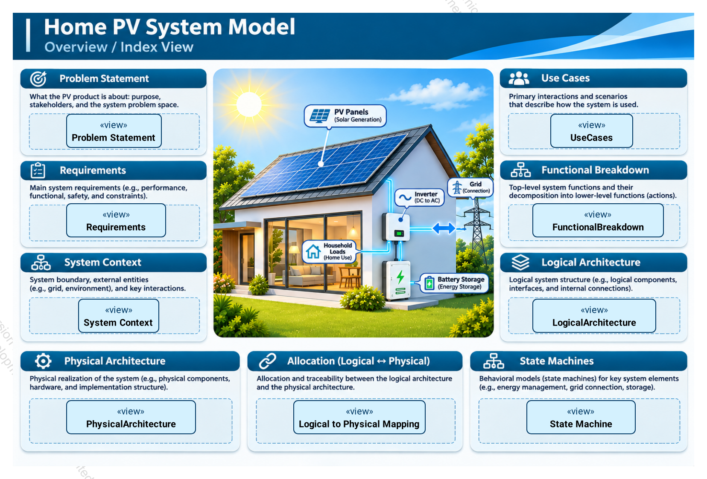

# HomePV-SYSMOD

A SysML v2 model of a **grid-tied residential photovoltaic system with
battery storage**, built with the **SYSMOD** method from the problem
statement down to the physical devices.

**New to modeling? Start with the [walkthrough](WALKTHROUGH.md).** It
explains the model step by step, using the diagrams in `Views/`.

[🔍 Open full size](Views/png/HomePVSystemModel__Index.png?raw=true) · [vector SVG](Views/HomePVSystemModel__Index.svg)

## What's in this folder

| File / folder | Content |
|---|---|
| [`WALKTHROUGH.md`](WALKTHROUGH.md) | Step-by-step explanation of the model for non-modelers |
| [`HomePVSystemModel.sysml`](HomePVSystemModel.sysml) | The model in SysML v2 textual notation, with `doc` comments explaining each step and its design decisions |
| `HomePV-Baseline.mdszip` | The Cameo (CATIA Magic) project, including the diagrams |
| [`Views/`](Views/) | Diagrams exported from Cameo as SVG (vector source) |
| [`Views/png/`](Views/png/) | The same diagrams as PNG at double resolution, for reading on GitHub. Click "Open full size" under a diagram, then zoom in your browser |
| [`HomePV-model-docs.md`](HomePV-model-docs.md) | The model documentation as a per-element list, for entering it in Cameo's Documentation fields |

## Model structure

Each SYSMOD step is its own package inside the project `HomePVSystemProject`:

| Package | SYSMOD step | Diagram |
|---|---|---|
| `HPVS-ProblemSpace` | 1 Problem Statement, 2 System Idea (base architecture), 3b Stakeholder Needs | [Problem Statement](Views/png/HPVS-ProblemSpace__Problem_Statement.png?raw=true) |
| `HPVS-Stakeholders` | 3 Stakeholders | — |
| `HPVS-Requirements` | 4 Requirements | [Satisfaction](Views/png/HPVS-PhysicalArchitecture__physicalArchitectureDiagram.png?raw=true) |
| `HPVS-ItemsDefinitions`, `HPVS-PortDefinitions`, `HPVS-Context` | 5 System Context | [System Context](Views/png/systemContext__System_Context.png?raw=true) |
| `HPVS-Functions`, `HPVS-UseCases` | 6 Use Cases with action flows | [Use Cases](Views/png/HPVS-UseCases__UseCases.png?raw=true), [supply](Views/png/supply_the_household_with_electricity__supply_the_household_with_electricityView.png?raw=true), [grid](Views/png/provide_electricity_to_the_grid__provide_electricity_to_the_gridView.png?raw=true), [monitor](Views/png/monitor_system_performance__monitor_system_performanceView.png?raw=true) |
| `HPVS-FunctionalBreakdown` | 7a Functional Breakdown | [Functional Breakdown](Views/png/HPVS-FunctionalBreakdown__FunctionalBreakdown.png?raw=true) |
| `HPVS-FunctionalArchitecture` | 7b Functional Architecture | [Functional Architecture](Views/png/homePVSystem__homePVSystemView_1.png?raw=true) |
| `HPVS-LogicalArchitecture` | 8 Logical Architecture, plus a state-machine simulation | [Logical Architecture](Views/png/homePVSystem__LogicalArchitecture.png?raw=true), [State Machines](Views/png/homePVSystem__State_Machine.png?raw=true) |
| `HPVS-PhysicalArchitecture` | 9 Physical Architecture | [Physical Architecture](Views/png/HPVS-PhysicalArchitecture__PhysicalArchitecture.png?raw=true), [Logical → Physical](Views/png/HomePVSystemProject__Logical_to_Physical_Mapping.png?raw=true) |

Traceability runs the whole way: needs frame the problem statement,
requirements frame the needs, use cases refine the requirements,
functions are allocated to functional parts, those to logical parts,
those to physical components, and the physical system satisfies the
requirements.

## Open points

- Five requirements are not yet satisfied: safe and low-maintenance,
  electrical safety, permitting, commissioning, servicing. The
  commissioning and servicing use cases have no action flows yet, and no
  protection or fault-handling function exists.
- The installer's interaction (configuration in, commissioning report
  out) is defined in the system context but not yet served by any
  function.
- The state-machine simulation uses simplified, dimensionless values.
  `SolarEnvironment` declares `Integer` attributes with fractional
  values, which Syside reports as type errors.
- `HomePVSystem-PA` does not yet replace the base-architecture
  subsystems, so they appear as unconnected parts in
  [this view](Views/png/homePVSystem__homePVSystemView.png?raw=true).

## Tools

- **Cameo / CATIA Magic** (SysML v2): open the `.mdszip` project.
- **Syside** (Sensmetry, 0.8.6): validate the textual model with
  `syside check . -d project`. The `DS_Views` references are
  Cameo-specific view types and are reported as unresolved outside Cameo.
