# A walk through the HomePV model

This guide explains the HomePV system model step by step. You don't need
any modeling knowledge to follow it. Every step shows one diagram from the
`Views/` folder and says in plain words what it tells you.

The model describes a **solar power system for a family home**: panels on
the roof, a battery in the basement, a connection to the public power
grid, and an app for the homeowner. It was built with **SysML v2**, a
language engineers use to describe systems precisely, following
**SYSMOD**, a step-by-step method that starts with the problem and ends
with the real devices.

> The watermark "Academic Version for Teaching Only" on the diagrams
> comes from the modeling tool license. It has nothing to do with the
> content.

---

## Before you start: how to read the diagrams

You only need five things:

| What you see | What it means |
|---|---|
| A **box** | A thing: a person, a device, a requirement, an activity |
| A **box inside a box** | The inner thing is part of the outer thing |
| A **small square on the edge of a box** | A connection point, called a *port*: where something enters or leaves. A small arrow inside it shows the direction, and a double arrow means both ways |
| A **line between two boxes** | The two are connected, or something flows between them |
| A word in «angle brackets», e.g. «part», «requirement» | The kind of element, so you know what you are looking at |

Names like `homeowner` or `energyMeter` are written as one word because
the model is also a text file that a computer checks. Text after a colon
(`energyMeter : EnergyMeter`) names the *kind* of thing, before the colon
is *this particular* thing.

---

## The map

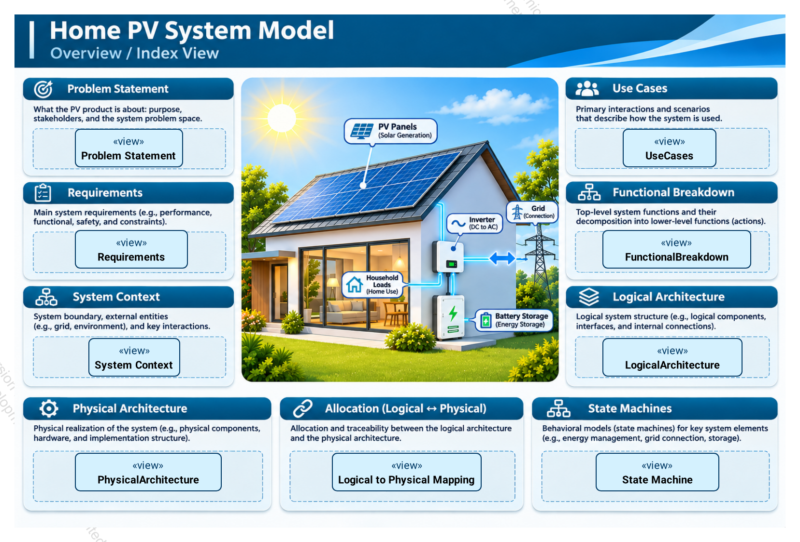

[🔍 Open full size](Views/png/HomePVSystemModel__Index.png?raw=true) · [vector SVG](Views/HomePVSystemModel__Index.svg)

This is the model's front page. Each tile is one chapter. The walkthrough
follows them in the order the system was designed:

```
 WHY            WHAT FOR                    HOW                     WITH WHAT
 problem   ->   context, use cases,     ->  functions, blocks,  ->  real devices,
 & needs        activities                  principles, behaviour   mapping, check
 (Step 1)       (Steps 2-4)                 (Steps 5-8)             (Steps 9-11)
```

---

## Step 1: The problem and who cares about it

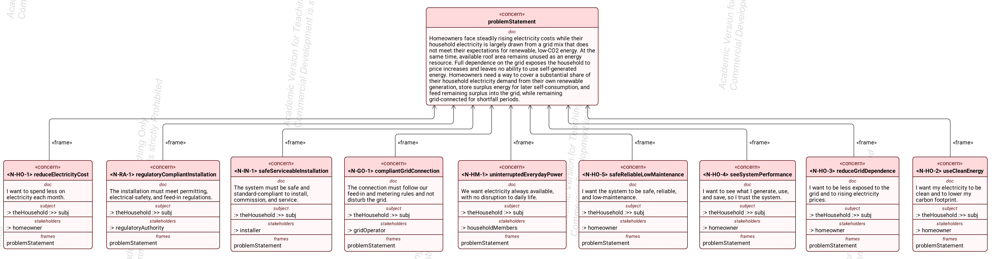

[🔍 Open full size](Views/png/HPVS-ProblemSpace__Problem_Statement.png?raw=true) · [vector SVG](Views/HPVS-ProblemSpace__Problem_Statement.svg)

**The box at the top** is the problem the system has to solve:
electricity keeps getting more expensive, it doesn't come from clean
sources, and the roof sits there unused. The household wants to produce
its own clean electricity, store what it doesn't need right away, sell
the rest, and still be connected to the grid for the times when the sun
isn't enough.

**The boxes along the bottom** are the **needs** of the people involved,
each written in that person's own words:

| Who | Wants |
|---|---|
| Homeowner | to spend less on electricity, use clean energy, depend less on the grid, see what the system does, and have a safe, low-maintenance system |
| Household members | power that is always there, with no disruption to daily life |
| Grid operator | a connection that follows the feed-in and metering rules and doesn't disturb the grid |
| Installer | a system that is safe and standard-compliant to install and service |
| Regulatory authority | permits, electrical safety and feed-in regulations met |

Every need points up to the problem with a line labeled «frame». That
line means *this need is part of that problem*. This is where the trace
starts: later, every requirement points to a need, and so on down to the
devices.

---

## Step 2: The system in its surroundings

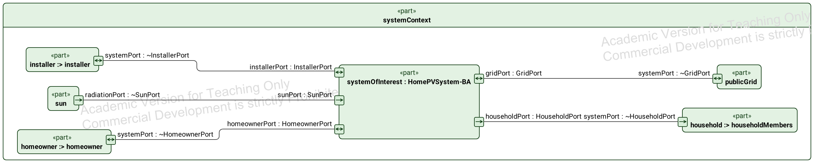

[🔍 Open full size](Views/png/systemContext__System_Context.png?raw=true) · [vector SVG](Views/systemContext__System_Context.svg)

The **system in the middle** is the solar power system, still seen as a
closed box. Around it is everything it deals with:

```
   installer ──── settings in, report out ────┐
   sun ────────── sunlight in ────────────────┤
   homeowner ──── request in, data out ───────┤ HomePV ├── electricity both ways ── public grid
                                              │ system ├── electricity out ──────── household
```

- The **sun** delivers sunlight.
- The **public grid** takes electricity the house doesn't need and
  supplies electricity when the house is short. That's why its
  connection carries energy in both directions.
- The **household** receives electricity.
- The **homeowner** asks to see the system's performance and gets the
  figures back.
- The **installer** enters settings at installation and gets a
  commissioning report.

The model draws a line here between the grid *operator* (a company with
rules, see Step 1) and the grid *itself* (the wires the energy actually
travels on). Only the wires have a connection to the system.

---

## Step 3: What the system is used for

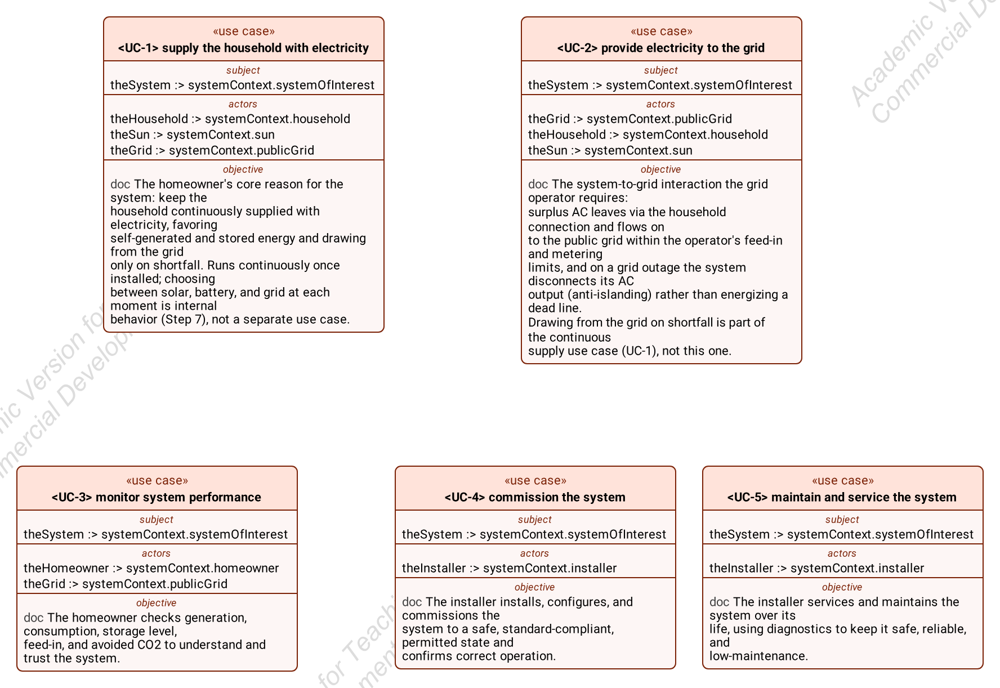

[🔍 Open full size](Views/png/HPVS-UseCases__UseCases.png?raw=true) · [vector SVG](Views/HPVS-UseCases__UseCases.svg)

A **use case** is one reason someone uses the system. There are five:

| Use case | In plain words |
|---|---|
| Supply the household with electricity | The main job. Keep the house supplied, use solar and battery first, and use the grid only when they are not enough |
| Provide electricity to the grid | Sell surplus to the grid under the operator's rules, and disconnect safely if the grid fails, so no one working on a "dead" line gets hurt |
| Monitor system performance | The homeowner checks generation, consumption, battery level, feed-in and the CO2 avoided |
| Commission the system | The installer sets the system up and confirms it works |
| Maintain and service the system | The installer keeps it safe and working over the years |

Each use case lists the **subject** (always the system), the **actors**
(who takes part) and the **objective** (what it is for).

---

## Step 4: What happens inside each use case

The first three use cases are worked out in detail. Each diagram shows
**activities** (the rounded boxes) and what **flows** between them.

### 4a: Supplying the household

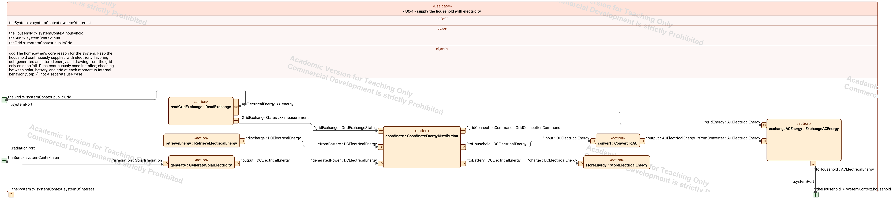

[🔍 Open full size](Views/png/supply_the_household_with_electricity__supply_the_household_with_electricityView.png?raw=true) · [vector SVG](Views/supply_the_household_with_electricity__supply_the_household_with_electricityView.svg)

Read it from left to right:

```
 sunlight ─► generate ─► coordinate ─► convert DC→AC ─► exchange AC energy ─► household
                          ▲   │  ▲                           ▲
            grid reading ─┘   │  └─ retrieve from battery    │
                              └──► store in battery          └─ grid (both ways)
```

1. **Generate**: the panels turn sunlight into direct current (DC).
2. **Coordinate**: the "brain" decides where the energy goes right
   now: to the house, into the battery, or out to the grid. To decide,
   it gets a **reading of the grid connection** (are we buying or
   selling at this moment?).
3. **Store / retrieve**: the battery takes in surplus and gives it back
   later, both as DC.
4. **Convert**: DC is turned into alternating current (AC), which is
   what the house and the grid use. This happens only once, at the end,
   so the battery and the brain stay on the DC side.
5. **Exchange AC energy**: the connection point supplies the house and
   trades the difference with the grid.

### 4b: Providing electricity to the grid

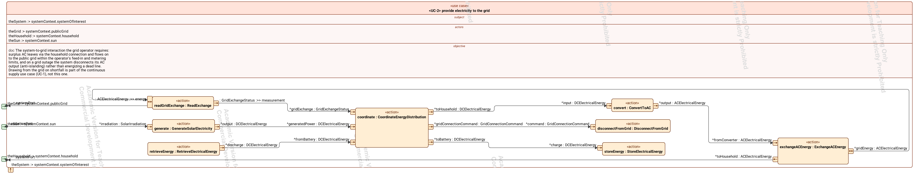

[🔍 Open full size](Views/png/provide_electricity_to_the_grid__provide_electricity_to_the_gridView.png?raw=true) · [vector SVG](Views/provide_electricity_to_the_grid__provide_electricity_to_the_gridView.svg)

It's the same chain, with one addition on the right: **disconnect from
grid**. The brain can order the system to separate itself from the grid,
for example during a power outage. The model deliberately keeps
*deciding* to disconnect (the brain) separate from *actually
disconnecting* (a switch). A decision on its own switches nothing.

### 4c: Monitoring performance

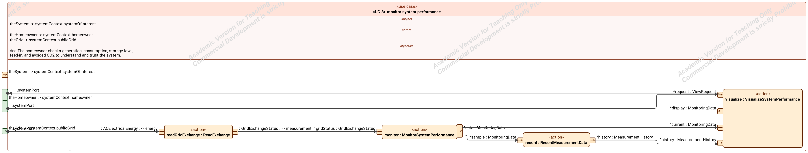

[🔍 Open full size](Views/png/monitor_system_performance__monitor_system_performanceView.png?raw=true) · [vector SVG](Views/monitor_system_performance__monitor_system_performanceView.svg)

```
 grid reading ─► monitor ─► record ─► history ─┐
                    └──── current data ────────┼─► visualize ─► homeowner
                         homeowner's request ──┘
```

The system watches itself continuously, keeps a history, and shows both
the current figures and the history when the homeowner asks.

---

## Step 5: All functions in one tree

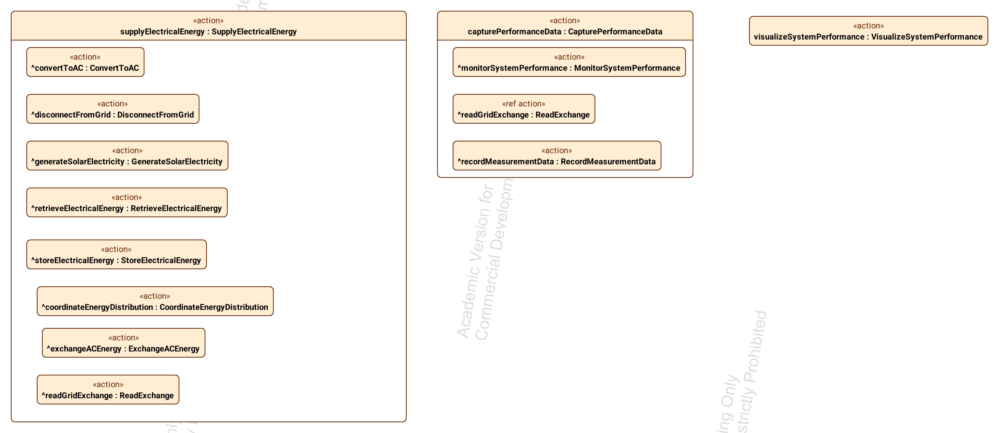

[🔍 Open full size](Views/png/HPVS-FunctionalBreakdown__FunctionalBreakdown.png?raw=true) · [vector SVG](Views/HPVS-FunctionalBreakdown__FunctionalBreakdown.svg)

The activities from Step 4 are collected into three groups:

- **Supply electrical energy**: everything that keeps energy flowing
  (generate, store, retrieve, coordinate, convert, read the grid,
  exchange, disconnect).
- **Capture performance data**: watch and record.
- **Visualize system performance**: on its own, because it happens only
  when the homeowner asks, independently of the other two.

The grid reading is used by both the supply group and the capture group.
It is defined once. The capture group only *refers* to it, which is what
the label «ref action» means.

Nothing in this tree was invented here. Every function comes from a use
case.

---

## Step 6: Who does what (functional architecture)

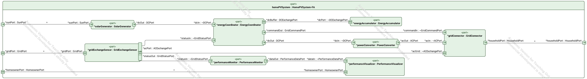

[🔍 Open full size](Views/png/homePVSystem__homePVSystemView_1.png?raw=true) · [vector SVG](Views/homePVSystem__homePVSystemView_1.svg)

Now the functions are handed to **responsible blocks**. Each block is
named after the work it does, not after a product:

| Block | Its job |
|---|---|
| Solar generator | produce DC from sunlight |
| Energy coordinator | decide where the energy goes, and when to disconnect |
| Energy accumulator | store and give back energy |
| Power converter | turn DC into AC |
| Grid exchange sensor | measure what crosses the grid connection |
| Grid connector | supply the house, trade with the grid, disconnect on command |
| Performance monitor | watch and record |
| Performance visualizer | show the figures to the homeowner |

**The lines between the blocks are not drawn by hand.** They follow
from Step 4: wherever energy or data flowed between two activities that
now sit in different blocks, those blocks need a connection. The
connections on the outer edge are exactly the ones from the system
context in Step 2, so the two diagrams have to match.

---

## Step 7: Technical principles (logical architecture)

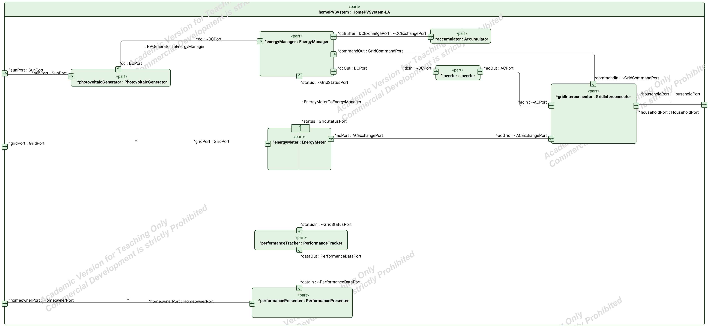

[🔍 Open full size](Views/png/homePVSystem__LogicalArchitecture.png?raw=true) · [vector SVG](Views/homePVSystem__LogicalArchitecture.svg)

Each block from Step 6 now becomes a **technical solution principle**,
still without choosing a product:

| Responsible block (Step 6) | Technical principle (Step 7) |
|---|---|
| Solar generator | Photovoltaic generator |
| Energy coordinator | Energy manager |
| Energy accumulator | Accumulator |
| Power converter | Inverter |
| Grid exchange sensor | Energy meter |
| Grid connector | Grid interconnector |
| Performance monitor | Performance tracker |
| Performance visualizer | Performance presenter |

The structure stays the same. What changes is that the names now commit
to *how* something is done ("an inverter"), but not yet to *which
product* does it.

---

## Step 8: How it behaves over time

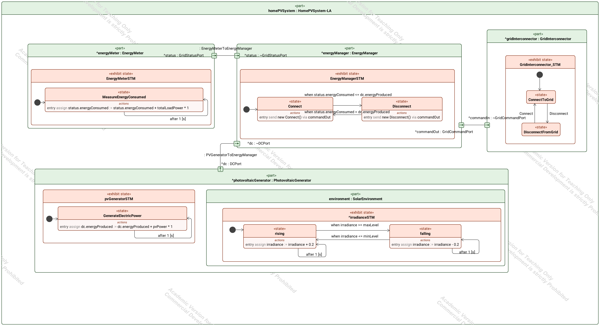

[🔍 Open full size](Views/png/homePVSystem__State_Machine.png?raw=true) · [vector SVG](Views/homePVSystem__State_Machine.svg)

This diagram turns the logical architecture into a small **simulation**
you can run, to see the parts working together. Each pink box is a
**state machine**, a description of the states a part can be in and what
makes it switch:

- **Solar environment** (bottom right): the sunlight rises step by step
  every second up to a maximum, then falls back to a minimum, like a
  very fast day.
- **PV generator** (bottom left): every second it adds the power it
  produces from the current sunlight to its running total.
- **Energy meter** (top left): every second it adds the household's
  consumption to its running total.
- **Energy manager** (top middle): compares the two totals. While the
  house has used more than the panels have produced, it sends
  **Connect**; otherwise it sends **Disconnect**.
- **Grid interconnector** (right): follows the command and switches
  between *connected to grid* and *disconnected from grid*.

The numbers in this simulation are simplified teaching values, not data
from a real system.

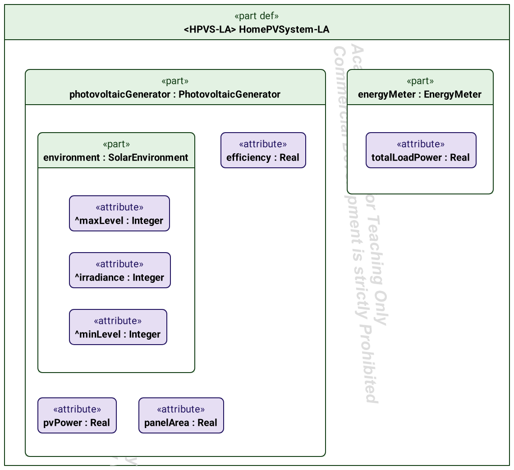

[🔍 Open full size](Views/png/HomePVSystem-LA__HomePVSystem-LAView.png?raw=true) · [vector SVG](Views/HomePVSystem-LA__HomePVSystem-LAView.svg)

This small diagram lists the values the simulation uses: the panel area,
the efficiency, the household load, and the range the sunlight moves in.

---

## Step 9: The real devices (physical architecture)

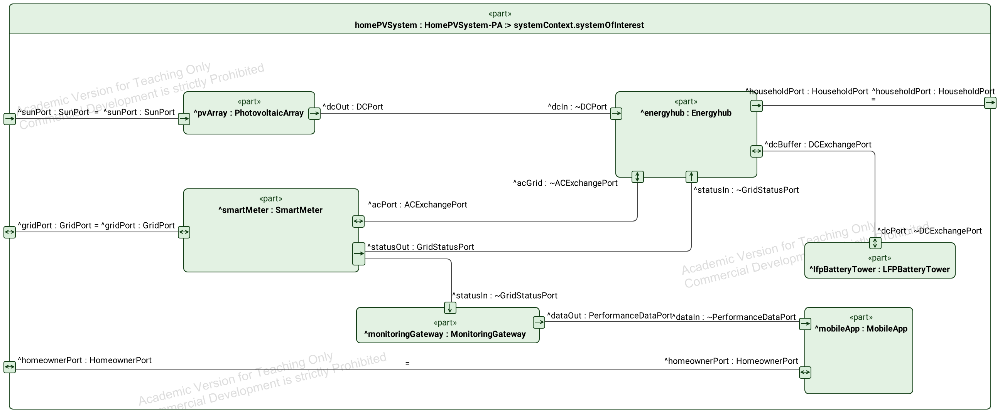

[🔍 Open full size](Views/png/HPVS-PhysicalArchitecture__PhysicalArchitecture.png?raw=true) · [vector SVG](Views/HPVS-PhysicalArchitecture__PhysicalArchitecture.svg)

This is what you would actually see installed in the house:

```
 roof               utility room                              your phone
┌──────────────┐ DC ┌───────────┐  DC  ┌──────────────────┐   ┌────────────┐
│ PV array     │───►│ Energy hub│◄────►│ LFP battery tower│   │ Mobile app │
└──────────────┘    │ (hybrid   │      └──────────────────┘   └─────▲──────┘
                    │ inverter) │──AC──► household                  │ data
                    └──▲─────▲──┘                                   │
                  AC   │     │ meter reading     ┌──────────────────┴─┐
                  ┌────┴─────┴──┐ ───────────────► Monitoring gateway │
 public grid ◄───►│ Smart meter │                 └────────────────────┘
                  └─────────────┘
```

| Device | What it is | Takes over (from Step 7) |
|---|---|---|
| PV array | the panels on the roof | photovoltaic generator |
| Energy hub | one box combining inverter, energy management and grid switch, as common hybrid inverters do | inverter, energy manager, grid interconnector |
| LFP battery tower | the home battery (lithium iron phosphate) | accumulator |
| Smart meter | the billing meter at the grid connection, owned by the grid operator | energy meter |
| Monitoring gateway | a small device that records the measurements | performance tracker |
| Mobile app | the app on the homeowner's phone | performance presenter |

**Design decisions:**

- **Three logical parts in one box.** The inverter, the energy manager
  and the grid switch work so closely together that real products build
  them into one device. Their connections now run inside the energy hub,
  which is why fewer lines run between devices than in Step 7.
- **The battery sits on the DC side** of the energy hub. Solar energy
  that goes into the battery is converted to AC only once, when it is
  used, which loses less energy.
- **The smart meter is its own device**, because it belongs to the grid
  operator and is the point where billing happens.
- **The app runs on the homeowner's phone**, not on the system's own
  hardware.

A second version of this diagram,
[`homePVSystem__homePVSystemView.svg`](Views/png/homePVSystem__homePVSystemView.png?raw=true),
also shows six unconnected boxes at the bottom (`pvGenerationSystem`,
`energyStorageSystem`, …). These are the first rough outline of the
system from the start of the project. In this version they are not yet
replaced by the real devices, so they appear as leftovers.

---

## Step 10: From principle to device

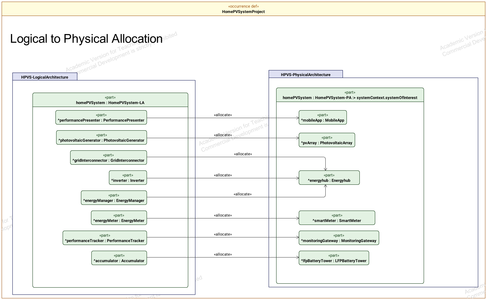

[🔍 Open full size](Views/png/HomePVSystemProject__Logical_to_Physical_Mapping.png?raw=true) · [vector SVG](Views/HomePVSystemProject__Logical_to_Physical_Mapping.svg)

Each arrow «allocate» says: *this technical principle is realized by
that device*. The three arrows meeting at the **energy hub** show the
"three in one box" decision. Every device on the right has at least one
arrow, so no device exists without a reason.

---

## Step 11: Are the requirements met?

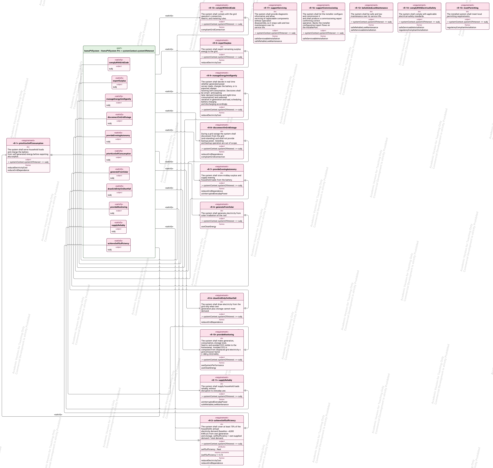

[🔍 Open full size](Views/png/HPVS-PhysicalArchitecture__physicalArchitectureDiagram.png?raw=true) · [vector SVG](Views/HPVS-PhysicalArchitecture__physicalArchitectureDiagram.svg)

The green box in the middle is the finished physical system. Each
«satisfy» line points to a **requirement** (pink boxes) the system meets.
Among them:

- serve the house and charge the battery before selling anything
- cover at least **70 %** of the household's yearly electricity
  (about 4,000 kWh) from its own generation and storage
- sell the remaining surplus to the grid
- buy from the grid only when solar and battery are not enough
- supply the house in the evening from the battery
- decide intelligently, in real time, where energy goes
- disconnect from the grid during an outage
- show generation, consumption, battery level, feed-in and CO2 avoided
- supply the house reliably and follow the grid operator's rules

**Five requirements at the top right have no line.** They are *not yet*
met by the model:

| Requirement | Why it is still open |
|---|---|
| Be safe and low-maintenance | no function for protection or fault handling has been modeled yet |
| Comply with electrical-safety standards | same reason |
| Meet local permitting | same reason |
| Support commissioning | the "commission the system" use case has no worked-out activities yet |
| Support servicing | the "maintain and service" use case has no worked-out activities yet |

These are honest gaps, not mistakes. The model shows exactly where the
next design work is needed, instead of hiding it behind a device that
nothing actually requires.

---

## Glossary

| Term | Meaning |
|---|---|
| **AC / DC** | Alternating / direct current. Panels and batteries work with DC; the house and the grid use AC |
| **Actor** | Someone or something outside the system that interacts with it |
| **Allocate** | Assign: "this function is done by that block", "this block is realized by that device" |
| **Anti-islanding** | The system disconnects when the grid fails, so it doesn't energize lines that technicians believe are dead |
| **Port** | A connection point on a box, where something enters or leaves |
| **Requirement** | A statement of what the system *shall* do, checked at the end |
| **Satisfy** | The finished system meets a requirement |
| **State machine** | A description of the states something can be in and what makes it switch |
| **Stakeholder** | A person or organization with an interest in the system |
| **SysML v2** | The modeling language used here |
| **SYSMOD** | The step-by-step method followed here |
| **Use case** | One reason someone uses the system |
